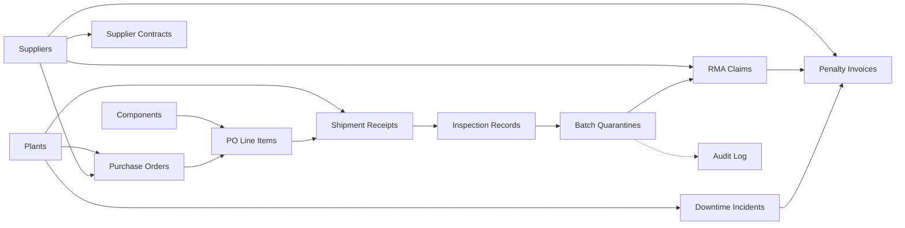

# Vendor Quality & Compliance Management System (VQCMS - XII)
### Enterprise Relational Database Project & Academic Defense Suite
**Institution:** K J Somaiya Institute of Management, Somaiya Vidyavihar University, India  
**Program & Batch:** Batch MCA 2026–2028 | **Course:** Database Management Systems (DBMS) | **Group:** Team 12

[](#)
[](#)
[](#)
[](#)
[](#)

---

## 1. Executive Summary & Problem Context

This project delivers a relational database architecture, comprehensive technical documentation, and an analytical query suite for **Precision Auto Parts**, an automotive OEM sourcing **4,200 unique engine and transmission components** across **185 global Tier-1 and Tier-2 suppliers** operating across **4 manufacturing plants** (Detroit, Stuttgart, Chennai, Shanghai).

### The Business Crisis
- **Rising Defect Rates:** Surging component defect rates on active assembly lines led to a **14% increase in factory downtime** and multimillion-dollar vehicle recall risks.
- **Spreadsheet Data Silos:** Batch inspection certs were recorded in isolated Excel workbooks across the 4 plants.
- **Missed Warranty Recovery:** When defective lots halted production lines, procurement officers could not cross-reference batch inspection certs with supplier contracts to recover warranty refunds or charge back downtime costs.
- **Subjective Vendor Scoring:** Lack of unified metrics for defect Parts-Per-Million (PPM), delivery timelines, and Return Merchandise Authorization (RMA) resolution.

---

## 2. Project Directory & Artifact Index

All documentation, data models, and database scripts are organized in GitHub Flavored Markdown and standard SQL:

```
DBMS_Team_12/
├── DBMS Group 12 - 1st PPT.pptx           <-- Official Somaiya Template Presentation Deck (14 Slides)
├── build_pptx.py                          <-- Python Script Generating the Master Presentation
├── diagrams/                              <-- Standalone Professional PlantUML (.puml) Suite
│   ├── 01_entity_relationship.puml        <-- Crow's Foot Relational ERD with PK/FK & Stereotypes
│   ├── 02_system_architecture.puml        <-- Multi-Plant Ingestion, OLTP Engine, ERP & BI Gateway
│   ├── 03_quarantine_state_machine.puml   <-- Batch Lifecycle & Quarantine State Machine Diagram
│   └── 04_penalty_enforcement_sequence.puml <-- Assembly Line Stoppage to Debit Memo Sequence
├── docs/
│   ├── 01_requirements_specification.md   <-- Requirements, Key Terms, In/Out Scope, Enterprise Specs
│   ├── 02_data_model_and_architecture.md   <-- Normalization (1NF-BCNF), Mermaid & PlantUML Models, RBAC
│   ├── 03_presentation_guide.md           <-- Slide-by-slide deck blueprint, Speaker scripts & Viva Q&A
│   ├── 04_web_presentation_plan.md       <-- Interactive web presentation architecture & framework evaluation
│   ├── 05_deployment_and_web_implementation_plan.md <-- Vercel/GitHub Pages deployment & phase-wise build plan
│   ├── 06_master_execution_plan.md        <-- 12-Phase master checklist with 80 sub-tasks
│   ├── 07_presentation_slides_master.md   <-- 14-Slide complete PPT master blueprint (2 slides per member)
│   ├── 08_team_slides_content_handout.md   <-- Clean slide-by-slide copy-paste content & talking points for teammates
│   └── Problem statement .jpeg            <-- Original assignment problem statement sheet
├── web/                                   <-- Interactive Web Presentation Dashboard
│   ├── index.html                         <-- Single-Page App (Tailwind + Chart.js + sql.js WASM)
│   ├── css/custom.css                     <-- Corporate automotive styling
│   ├── js/app.js                          <-- Tab navigation, charts, audit timeline, viva panel
│   ├── js/database.js                     <-- WebAssembly SQLite engine (sql.js)
│   ├── js/queries_data.js                 <-- All 11 queries as JS objects with metadata
│   ├── data/vqcms.db                      <-- Binary SQLite database for in-browser execution
│   └── vercel.json                        <-- Vercel deployment configuration
├── sql/
│   ├── schema.sql                         <-- DDL: 14 Tables, Constraints, Indexes, Triggers & Views
│   ├── seed_data.sql                      <-- DML: Multi-plant automotive supply chain mock dataset
│   └── queries.sql                        <-- 11 Business-critical analytical & transactional queries
├── server.py                              <-- Local Python server for offline presentation
├── verify_project.py                      <-- Automated end-to-end Python test harness
└── README.md                              <-- Master project documentation and execution guide
```

### Direct Links to Project Deliverables:
- [01 Entity Relationship Diagram (PlantUML)](file:///d:/DBMS_Team_12/diagrams/01_entity_relationship.puml)
- [02 Enterprise Architecture Diagram (PlantUML)](file:///d:/DBMS_Team_12/diagrams/02_system_architecture.puml)
- [03 Batch Quarantine State Machine (PlantUML)](file:///d:/DBMS_Team_12/diagrams/03_quarantine_state_machine.puml)
- [04 Penalty Enforcement Sequence Diagram (PlantUML)](file:///d:/DBMS_Team_12/diagrams/04_penalty_enforcement_sequence.puml)
- [Requirements Specification & Scope](file:///d:/DBMS_Team_12/docs/01_requirements_specification.md)
- [Data Models, PlantUML & Normalization](file:///d:/DBMS_Team_12/docs/02_data_model_and_architecture.md)
- [Presentation Blueprint & Viva Defense Guide](file:///d:/DBMS_Team_12/docs/03_presentation_guide.md)
- [Interactive Web Presentation Plan](file:///d:/DBMS_Team_12/docs/04_web_presentation_plan.md)
- [Deployment & Phase-Wise Implementation Plan](file:///d:/DBMS_Team_12/docs/05_deployment_and_web_implementation_plan.md)
- [Master Execution Plan (12 Phases)](file:///d:/DBMS_Team_12/docs/06_master_execution_plan.md)
- [**14-Slide Master PPT Blueprint (2 Slides/Member)**](file:///d:/DBMS_Team_12/docs/07_presentation_slides_master.md)
- [**Teammate Slide Content & Presenter Handout**](file:///d:/DBMS_Team_12/docs/08_team_slides_content_handout.md)
- [**Complete Generated Presentation Deck (.pptx)**](file:///d:/DBMS_Team_12/DBMS%20Group%2012%20-%201st%20PPT.pptx)
- [Presentation Generator Script](file:///d:/DBMS_Team_12/build_pptx.py)
- [**Interactive Web Dashboard**](file:///d:/DBMS_Team_12/web/index.html)
- [Database DDL Schema](file:///d:/DBMS_Team_12/sql/schema.sql)
- [Database Seed Data](file:///d:/DBMS_Team_12/sql/seed_data.sql)
- [SQL Analytical Query Suite](file:///d:/DBMS_Team_12/sql/queries.sql)
- [Local Presentation Server](file:///d:/DBMS_Team_12/server.py)
- [Automated Verification Script](file:///d:/DBMS_Team_12/verify_project.py)

---

## 3. Assignment Requirements Cross-Reference Matrix

| Professor's Assignment Requirement | Project Deliverable / File | Implementation Details |
| :--- | :--- | :--- |
| **1. Analyse Requirements** | [01_requirements_specification.md](file:///d:/DBMS_Team_12/docs/01_requirements_specification.md#L14-L35) | Root-cause analysis of 14% downtime, siloed Excel files, and recall exposures. |
| **2. Identify & Define Key Terms** | [01_requirements_specification.md](file:///d:/DBMS_Team_12/docs/01_requirements_specification.md#L37-L55) | Definitions for Defect PPM, RMA, CoA, Quarantine, PO, SLA, Debit Memos. |
| **3. Document Scope & Out-of-Scope** | [01_requirements_specification.md](file:///d:/DBMS_Team_12/docs/01_requirements_specification.md#L57-L95) | Deliberate boundaries separating quality engine from banking gateways & CNC lines. |
| **4. Relational Normalization** | [02_data_model_and_architecture.md](file:///d:/DBMS_Team_12/docs/02_data_model_and_architecture.md#L11-L60) | Formal progression: 1NF (atomic values), 2NF (no partial deps), 3NF/BCNF (no transitive deps). |
| **5. ER Diagram & Visual Design** | [02_data_model_and_architecture.md](file:///d:/DBMS_Team_12/docs/02_data_model_and_architecture.md#L62-L290) | Both **Mermaid ER** (browser-native) and **PlantUML** (vector theme) models with cardinalities. |
| **6. Identify Attributes & Design Tables** | [sql/schema.sql](file:///d:/DBMS_Team_12/sql/schema.sql#L36-L200) | 14 Relational tables with strict `CHECK`, `NOT NULL`, `UNIQUE`, and `FK RESTRICT` constraints. |
| **7. Calculate Real-Time Supplier PPM** | [sql/queries.sql](file:///d:/DBMS_Team_12/sql/queries.sql#L10-L38) | SQL formula: `(Defects / Sample Size) * 1,000,000` compared to contractual threshold. |
| **8. Automated Penalty Invoicing** | [sql/queries.sql](file:///d:/DBMS_Team_12/sql/queries.sql#L68-L98) | Computes line stoppage fee: `(downtime_minutes / 60) * hourly_penalty` + base fee. |
| **9. Batch Quarantine & RMA Audit Trail** | [sql/queries.sql](file:///d:/DBMS_Team_12/sql/queries.sql#L100-L135) | Multi-table audit trail tracking dock delivery $\to$ quarantine hold $\to$ RMA settlement. |
| **10. "Thinking Beyond" Enterprise Level** | [01_requirements_specification.md](file:///d:/DBMS_Team_12/docs/01_requirements_specification.md#L145-L165) & [02_data_model_and_architecture.md](file:///d:/DBMS_Team_12/docs/02_data_model_and_architecture.md#L292-L345) | Bi-temporal lot tracking, RBAC security matrix, automated debit triggers, and range partitioning. |
| **11. Presentation & Defense Blueprint** | [03_presentation_guide.md](file:///d:/DBMS_Team_12/docs/03_presentation_guide.md) | 10-slide outline, speaker notes, and high-probability viva defense Q&A. |

---

## 4. Entity-Relationship Model Summary



### Relational Schema Tables:
1. `plants`: 4 manufacturing facilities with dock capacities and location data.
2. `suppliers`: 185 Tier-1 and Tier-2 suppliers with ISO status, compliance scores, and status flags.
3. `supplier_contracts`: SLAs, maximum allowable PPM thresholds, and hourly downtime penalty rates.
4. `components`: 4,200 parts cataloged with criticality tiers (A: Safety Critical, B: Functional, C: Standard).
5. `purchase_orders`: Multi-plant procurement contracts and orders.
6. `po_line_items`: Line item breakdown linking parts to purchase orders.
7. `shipment_receipts`: Physical dock deliveries, lot numbers, bills of lading, and carrier tracking.
8. `qc_inspectors`: Quality control personnel across all plants with certification credentials.
9. `inspection_records`: Quality inspection results, defect classification, and automated PPM scoring.
10. `batch_quarantines`: Containment isolation of suspect lots into warehouse quarantine bays.
11. `downtime_incidents`: Assembly line stoppage tracking, downtime minutes, and factory stoppage losses.
12. `rma_claims`: Formal warranty refund claims and replacement tracking with vendors.
13. `penalty_invoices`: Automated financial debit memos issued against vendor payables.
14. `compliance_audit_log`: Immutable ledger tracking every quarantine state transition.

---

## 5. Quick Start: Execution & Verification

### Option A: Automated One-Click Verification (Python)
Run the bundled verification script to build the database, insert seed data, and execute test queries:

```powershell
python verify_project.py
```

### Option B: Direct SQLite CLI Execution
```powershell
# 1. Create database and load schema
sqlite3 vqcms.db ".read sql/schema.sql"

# 2. Populate realistic automotive seed data
sqlite3 vqcms.db ".read sql/seed_data.sql"

# 3. Execute the 11 analytical business queries
sqlite3 vqcms.db ".read sql/queries.sql"
```

### Option C: PostgreSQL Deployment
All SQL scripts adhere to ANSI standards and run cleanly on PostgreSQL 13+:
```bash
psql -U postgres -d vqcms -f sql/schema.sql
psql -U postgres -d vqcms -f sql/seed_data.sql
psql -U postgres -d vqcms -f sql/queries.sql
```

---

## 6. Analytical SQL Query Suite Highlights

1. **Query 1: Real-Time Supplier Defect PPM:** Computes aggregate PPM across all received lots and marks suppliers exceeding SLA as `SLA_BREACH_PENALTY`.
2. **Query 2: Warranty Cross-Referencing:** Directly links failed inspection certificates with contractual warranty terms to calculate enforceable refund claim values.
3. **Query 3: Line Downtime Penalty Invoicing:** Calculates assembly line stoppage fees ($/minute) and associates debit memos with responsible vendors.
4. **Query 4: Complete Quarantine Audit Trail:** Traces suspect parts from receiving bay to quarantine hold and RMA settlement.
5. **Query 5: Downtime Analysis by Plant:** Quantifies the 14% factory downtime increase across engine and transmission subsystems.
6. **Query 6: Criticality Tier Ranking:** Uses SQL window functions (`DENSE_RANK() OVER (...)`) to isolate high-risk Tier A safety components.
7. **Query 11: Automated Governance & Suspension:** Uses complex multi-condition evaluation (PPM breach + downtime incidents) to recommend supplier probation or suspension.

---

## 7. Presentation & Defense Readiness

Refer to [docs/03_presentation_guide.md](file:///d:/DBMS_Team_12/docs/03_presentation_guide.md) for:
- 10-slide structured presentation flow.
- Exact word-for-word talking scripts for team members.
- Professor defense Q&A covering normalization, engine-level triggers, ACID guarantees, and scaling.
